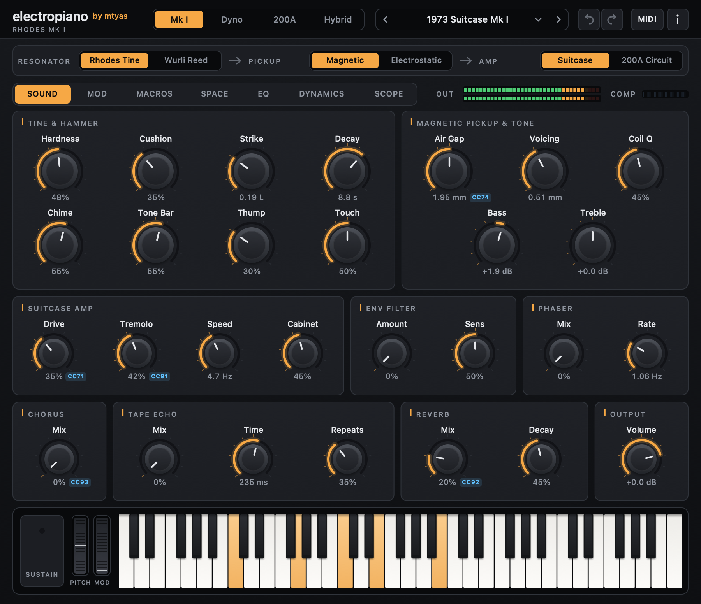
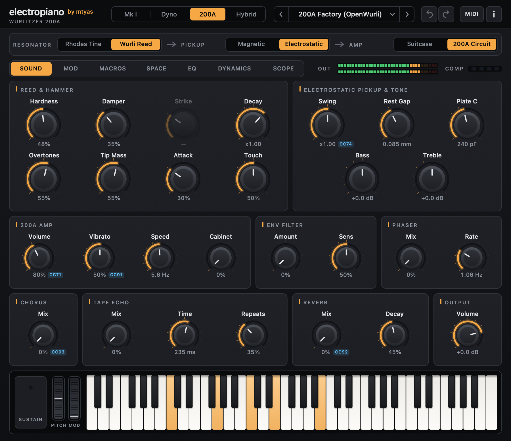
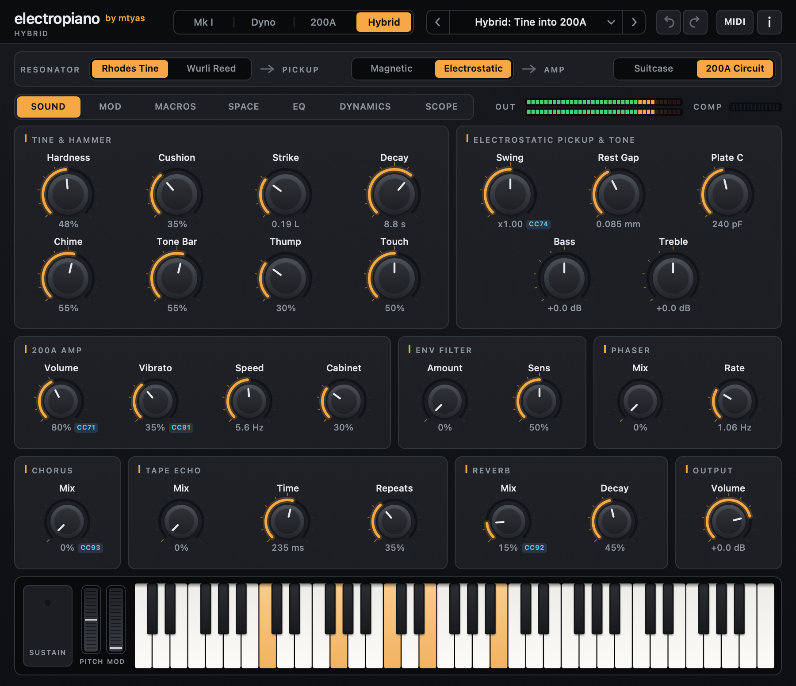
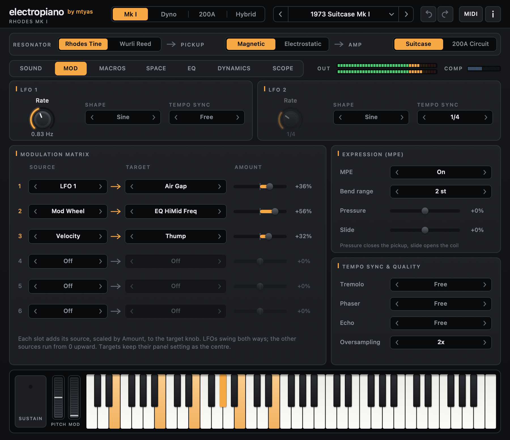
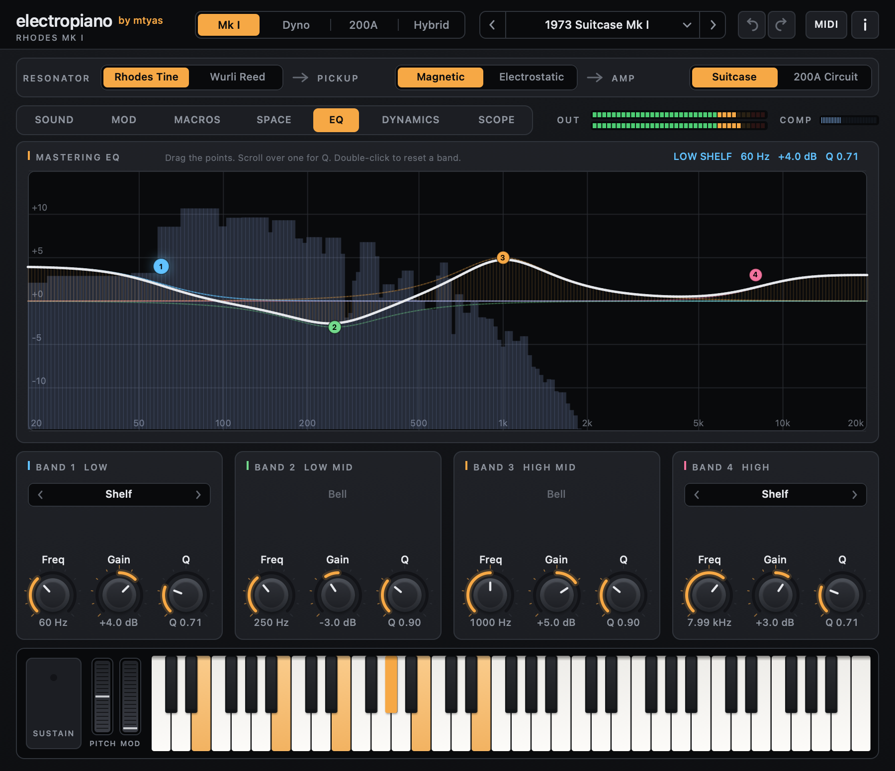
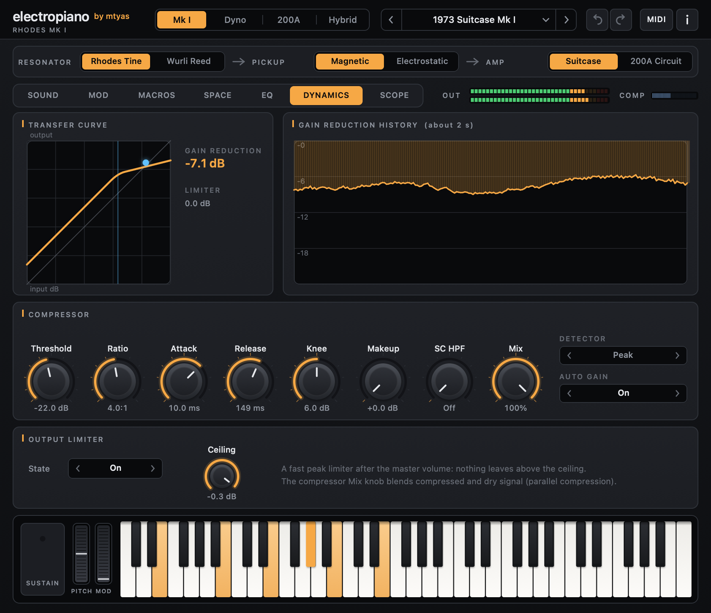
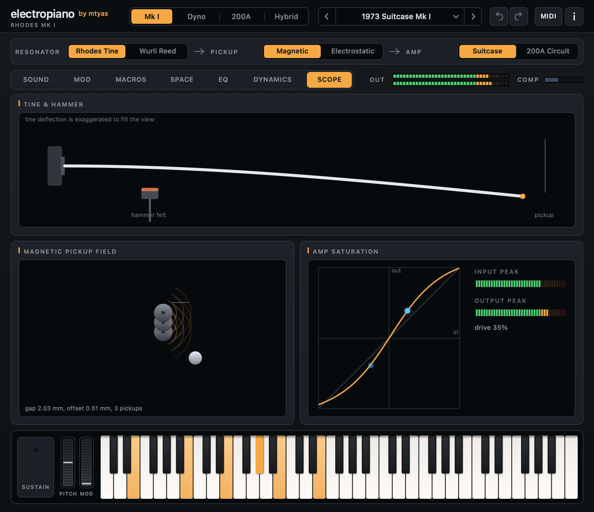

# electropiano

**Physically modelled Rhodes and Wurlitzer electric pianos — built from stages you can swap.**

[](https://github.com/mtyas/electropiano/actions/workflows/build.yml)
[](https://github.com/mtyas/electropiano/releases)
[](LICENSE)




electropiano doesn't play back recordings. Every note is computed from the mechanics and
electronics of the instrument: a felt hammer hitting a steel tine or reed, the vibration
passing a magnetic or electrostatic pickup, and an amplifier. Because the instrument is
simulated part by part, you can rebuild it — put a **Rhodes tine through a Wurlitzer 200A
amplifier**, or a **Wurlitzer reed on a Rhodes pickup**.

**[Download](https://github.com/mtyas/electropiano/releases)** ·
**[User manual](docs/MANUAL.md)** ·
[mtyas.com](https://mtyas.com) ·
[Support on Ko-fi](https://ko-fi.com/mtyas)

---

## Highlights

- **Two instruments, modelled properly**
  - **Fender Rhodes** (Mk I and Dyno voicings): a port-Hamiltonian hammer, tine and tone bar
    after Falaize & Hélie and [PyPHS](https://github.com/pyphs/pyphs), solved with an
    energy-conserving scheme, and their magnetic pickup law.
  - **Wurlitzer 200A**: a C++ port of [OpenWurli](https://github.com/hal0zer0/openwurli) —
    reed, electrostatic pickup and the 200A's amplifier simulated component by component.
- **Swappable stages** — Resonator (tine / reed) → Pickup (magnetic / electrostatic) →
  Amp (Suitcase / 200A circuit), mixed freely.
- **100+ controls** across seven pages, with labels and read-outs that follow the stages you
  choose: hammer, tine/reed, pickup geometry, amp, envelope filter, phaser, chorus, tape echo, reverb.
- **MPE and per-note expression** — per-note pitch bend (tines and reeds, even while they ring),
  pressure and slide; CLAP note expressions.
- **Modulation matrix** — two LFOs (five shapes, tempo sync), six slots, nine sources, 39 targets.
- **"Impossible instrument" macros** — tine material (steel → glass → carbon), up to four pickups,
  audio-rate gap FM, and a tine ⇄ reed **morph** inside a held note.
- **A mastering section** — four-band parametric EQ with an interactive curve and live spectrum,
  a full compressor and output limiter, nine miked cabinets with mic position, distance and room,
  spring or hall reverb, tempo-synced tremolo / phaser / echo, oversampled preamp.
- **A scope that shows the physics** — the tine and hammer, the pickup field, the amp saturating.
- **28 factory presets**, including OpenWurli's calibrated 200A and cross-instrument hybrids.
- **One editor on every platform**, MIDI learn, undo/redo, user presets, a playable keyboard.
- **CLAP and VST3** on macOS, Windows and Linux, plus **Audio Unit** and a **standalone app**
  on macOS.

<table>
<tr>
<td></td>
<td></td>
</tr>
<tr>
<td align="center">Wurlitzer 200A (OpenWurli)</td>
<td align="center">Hybrid: Rhodes tine through the 200A circuit</td>
</tr>
</table>

## One window, seven pages

<table>
<tr>
<td></td>
<td></td>
</tr>
<tr>
<td align="center">Modulation, MPE and tempo sync</td>
<td align="center">Four-band mastering EQ with live spectrum</td>
</tr>
<tr>
<td></td>
<td></td>
</tr>
<tr>
<td align="center">Compressor and limiter</td>
<td align="center">Scope: tine, hammer, pickup field, amp</td>
</tr>
</table>

## The signal chain


| Stage | Options |
|---|---|
| **Resonator** | **Rhodes Tine** — felt hammer, cantilever tine and tone bar (port-Hamiltonian). **Wurli Reed** — OpenWurli's modal reed, calibrated per key. |
| **Pickup** | **Magnetic** — Falaize & Hélie's flux law: the tine tip's horizontal and vertical offsets set bark and bell. **Electrostatic** — OpenWurli's field-solved reed-to-comb capacitance. |
| **Amp** | **Suitcase** — Rhodes preamp saturation and stereo auto-pan. **200A Circuit** — the 200A's two-transistor preamp with the LDR vibrato inside its feedback loop, volume network and power amp. |

The **Mk I / Dyno / 200A / Hybrid** buttons set all three stages at once. The
[manual](docs/MANUAL.md) explains every control.

## Install

Grab the archive for your system from
[Releases](https://github.com/mtyas/electropiano/releases):

| System | Copy | To |
|---|---|---|
| macOS (Universal) | `electropiano.clap` / `.vst3` / `.component` | `~/Library/Audio/Plug-Ins/CLAP` / `VST3` / `Components` |
| Windows (x64) | `electropiano.clap` / `electropiano.vst3` | `C:\Program Files\Common Files\CLAP` / `VST3` |
| Linux (x64) | `electropiano.clap` / `electropiano.vst3` | `~/.clap` / `~/.vst3` |

The macOS builds aren't notarised: if macOS blocks them, see
[Installing](docs/MANUAL.md#1-installing).

## Build from source

**macOS** (Xcode command-line tools):

```bash
make all                                      # CLAP, VST3, AU, standalone app, tests
make test                                     # passivity, OpenWurli port and plugin-load tests
make all ARCHFLAGS="-arch arm64 -arch x86_64" # universal binaries
```

**Windows** (Visual Studio 2022) and **Linux** (`libx11-dev`):

```bash
cmake -B build -DCMAKE_BUILD_TYPE=Release
cmake --build build --config Release
```

No external SDKs are needed: the CLAP and VST3 interfaces are in `include/`.

### Layout

| Path | |
|---|---|
| `src/dsp/` | Engine, Rhodes voice (`PhsVoice.hpp`), effects, cabinets (`PhsCabinet.hpp`), parameters, presets |
| `src/dsp/wurli/` | Wurlitzer 200A model (OpenWurli port) |
| `src/gui/` | Shared editor (`PhsEditor`), CoreGraphics / Win32 / X11 hosts, software renderer |
| `src/formats/` | CLAP, VST3, AU and standalone wrappers |
| `tools/` | Tests, screenshot and font-atlas generators |

## Verification

`make test` checks, among other things:

- **Energy conservation** of the Rhodes model: the discrete power balance holds on every
  sample to ~10⁻¹⁵ of the stored energy, including through hammer contact.
- **The OpenWurli port** against OpenWurli's SPICE-derived acceptance targets: preamp DC
  operating point within 0.1 mV, 15.56 dB gain at 1 kHz, 880.5 Hz pickup corner, field-solved
  pickup tables to 10⁻¹², and the Twin-T vibrato oscillator's rate and LED current.
- **MPE:** per-note bend reads within a fraction of a percent of the target pitch on tines and reeds,
  and one channel's bend never reaches another's.
- **Modulation, macros, tempo sync and oversampling** each have a measured test (LFO depth, morph =
  the other resonator exactly, echo lands on the beat, aliasing drops about 18 dB).
- **The curves you see are the audio you hear:** the EQ and cabinet responses drawn in the editor are
  checked against measured sine sweeps through the real processing; the compressor's slope against
  its ratio.
- That the CLAP, VST3 and AU builds load and render, and that older saved states still load.

## Credits

- **electropiano** by Matthew Tyas (mtyas).
- **Rhodes model** after Antoine Falaize & Thomas Hélie, *"Passive simulation of the nonlinear
  port-Hamiltonian modeling of a Rhodes piano"*, J. Sound Vib. 390 (2017), and
  [PyPHS](https://github.com/pyphs/pyphs). No PyPHS code is included; the published equations
  are implemented independently.
- **Wurlitzer 200A model**: [OpenWurli](https://github.com/hal0zer0/openwurli) by hal0zer0 and
  contributors, ported from Rust to C++. Please consider supporting the project.
- **Inter** typeface by The Inter Project Authors (SIL OFL 1.1), used in the Windows / Linux
  editor.

If you use electropiano in research, please cite:

```bibtex
@article{falaize2017passive,
  title   = {Passive simulation of the nonlinear port-Hamiltonian modeling of a Rhodes piano},
  author  = {Falaize, Antoine and H{\'e}lie, Thomas},
  journal = {Journal of Sound and Vibration},
  volume  = {390},
  pages   = {289--309},
  year    = {2017}
}
```

## Licence

electropiano is free software under the **GNU General Public License v3.0 or later** — see
[LICENSE](LICENSE). It is GPL because it incorporates OpenWurli (GPL-3.0).
