# electropiano — User Manual

**Version 0.82** · by Matthew Tyas (mtyas) · GPL-3.0

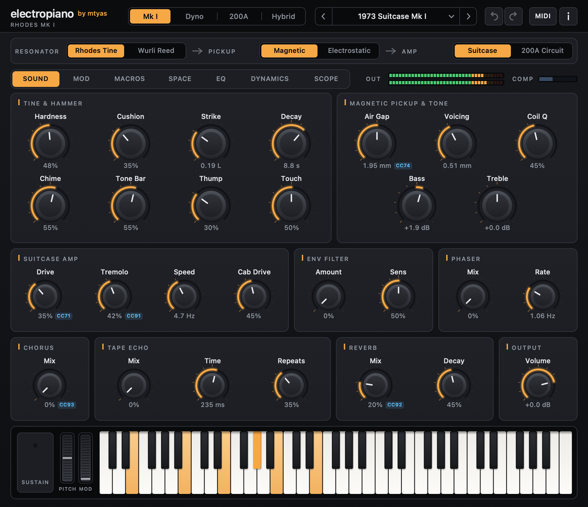

electropiano is a physically modelled electric piano. Nothing in it is sampled: every note
is computed from the mechanics and electronics of the instruments, so it responds to your
playing the way the real thing does, and you can reach inside and change how it is built.

It models two classic instruments:

- the **Fender Rhodes** (Mk I and Dyno-My-Piano voicings) — a felt hammer striking a steel
  tine, read by a magnetic pickup; and
- the **Wurlitzer 200A** — a hammer striking a steel reed, read by an electrostatic pickup and
  amplified by the 200A's own circuit.

What makes electropiano different is that each instrument is built from **stages you can
swap**: put a Rhodes tine in front of the Wurlitzer's pickup and amplifier, or a Wurlitzer
reed on a Rhodes pickup, and every combination in between.

On top of the instruments sits a modern production layer: **per-note MPE expression**, a
**modulation matrix** with two LFOs, "impossible instrument" **macros** (tine material, several
pickups, audio-rate gap FM, tine-to-reed morphing), a miked **cabinet** section, a four-band
**mastering EQ**, a full **compressor and limiter**, and a **scope** that shows the hammer, the
pickup field and the amp saturating in real time.

---

## Contents

1. [Installing](#1-installing)
2. [A quick tour](#2-a-quick-tour)
3. [The signal chain](#3-the-signal-chain)
4. [Resonator controls](#4-resonator-controls)
5. [Pickup and tone controls](#5-pickup-and-tone-controls)
6. [Amp](#6-amp)
7. [Effects](#7-effects)
8. [Modulation and expression](#8-modulation-and-expression)
9. [Macros: the impossible instrument](#9-macros-the-impossible-instrument)
10. [Space: reverb, echo and cabinets](#10-space-reverb-echo-and-cabinets)
11. [Mastering EQ and dynamics](#11-mastering-eq-and-dynamics)
12. [Scope](#12-scope)
12b. [Play: tuning, pedals and realism](#12b-play-tuning-pedals-and-realism)
13. [Presets](#13-presets)
14. [Playing, MIDI and automation](#14-playing-midi-and-automation)
15. [Tips for sound design](#15-tips-for-sound-design)
16. [Troubleshooting](#16-troubleshooting)
17. [How it works](#17-how-it-works)
18. [Credits and licence](#18-credits-and-licence)

---

## 1. Installing

Download the archive for your system from the
[Releases page](https://github.com/mtyas/electropiano/releases) and unzip it.

| System | Formats | Where to put them |
|---|---|---|
| **macOS** (Apple Silicon and Intel) | `electropiano.clap`, `electropiano.vst3`, `electropiano.component` (Audio Unit), `electropiano.lv2`, `electropiano.app` (standalone) | `~/Library/Audio/Plug-Ins/CLAP/`, `~/Library/Audio/Plug-Ins/VST3/`, `~/Library/Audio/Plug-Ins/Components/`, `~/Library/Audio/Plug-Ins/LV2/`, and the app anywhere you like |
| **Windows** (64-bit) | `electropiano.clap`, `electropiano.vst3`, `electropiano.lv2` | `C:\Program Files\Common Files\CLAP\`, `C:\Program Files\Common Files\VST3\` and `%APPDATA%\LV2\` |
| **Linux** (64-bit, X11) | `electropiano.clap`, `electropiano.vst3`, `electropiano.lv2` | `~/.clap/`, `~/.vst3/` and `~/.lv2/` |

Then rescan plugins in your DAW.

**macOS note.** The builds are not notarised by Apple. If macOS refuses to load them, remove
the download quarantine flag once, in Terminal:

```bash
xattr -dr com.apple.quarantine ~/Library/Audio/Plug-Ins/CLAP/electropiano.clap ~/Library/Audio/Plug-Ins/VST3/electropiano.vst3 ~/Library/Audio/Plug-Ins/Components/electropiano.component
```

The window is 900 × 776 pixels at 100 % and looks the same on all three systems. It can be
**resized**: drag the window's corner in hosts that allow it (CLAP, VST3, the standalone app), or
set **Zoom** (75 – 200 %) on the Play page; the zoom is remembered.

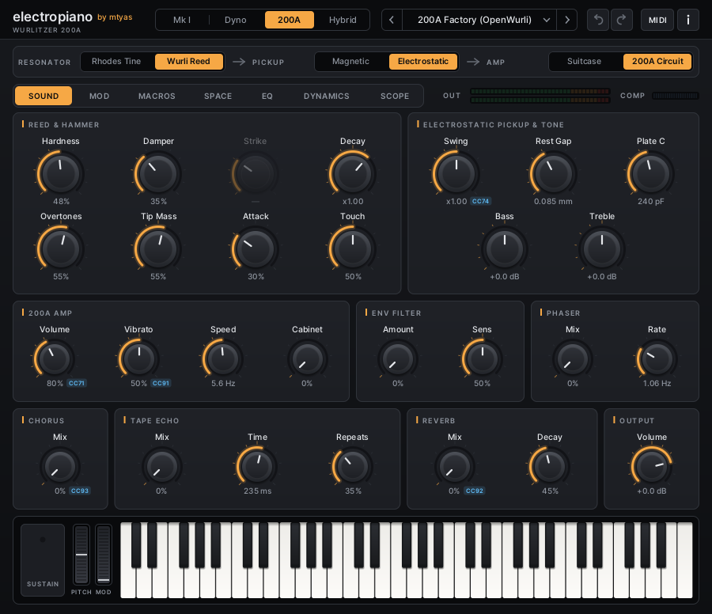

---

## 2. A quick tour

### Header


From left to right:

- **Instrument** — `Mk I`, `Dyno`, `200A`, `Hybrid`. Each button sets a whole instrument: its
  voicing *and* its three stages (see below). Choose one as a starting point.
- **Preset** — `‹` and `›` step through presets; click the name to open the preset browser.
- **Undo / Redo** — every knob move, preset change and stage change can be undone.
- **MIDI** — MIDI-learn mode (see [section 14](#14-playing-midi-and-automation)).
- **i** — about electropiano and the work it builds on.

### Signal chain


Three switches, read left to right: what vibrates (**Resonator**), what turns the vibration
into a voltage (**Pickup**) and what amplifies it (**Amp**). The panels below change their
names and controls to match what you select.

### Pages


Under the signal chain a **page bar** switches the middle of the window between eight pages.
The header, signal chain, keyboard and the live read-outs at the right of the bar stay on screen
on every page: **CPU** (the share of the real-time budget the plugin is using), voices in use out
of the polyphony, the **output meters** (peak L / R) and the compressor's gain reduction.

| Page | What it holds |
|---|---|
| **Sound** | The instrument panels: resonator, pickup, amp, filter, phaser, chorus, echo, reverb, output. |
| **Mod** | Two LFOs, the six-slot modulation matrix, MPE expression, tempo sync and oversampling. |
| **Macros** | Material, pickups, gap FM and morph. |
| **Space** | Cabinets and microphone, reverb and tape echo. |
| **EQ** | A four-band parametric mastering equaliser with an interactive curve and live spectrum. |
| **Dynamics** | Compressor and output limiter, with transfer curve and gain-reduction history. |
| **Scope** | The tine and hammer, the pickup field and the amp's saturation, live. |
| **Play** | Tuning and microtuning (Scala), transpose, polyphony, condition, sympathetic resonance, key spread, A/B compare and zoom. |

### Knobs

- **Drag** up and down to turn a knob. Hold **Shift** for fine control.
- **Double-click** a knob to return it to its default.
- **Scroll** over a knob to nudge it.
- **Right-click** a knob for *MIDI Learn*, *Forget MIDI CC* and *Reset to Default*.
- The orange arc shows the value; Bass and Treble arcs grow from the centre (cut ↔ boost).
- A small blue tag such as `CC74` means the knob is mapped to a MIDI controller.
- Larger knobs have a scale around them; the ticks the value has passed light up.

### Choosing from lists

Settings with several choices appear as a box with arrows (`‹ Sine ›`).
**Click the middle** to open a **list** of every choice and pick one; click the **arrows** to step
through them. Modulation sources and targets, LFO shapes, tempo divisions, cabinets and the
oversampling quality all work this way. Switches with two states simply toggle.

### Keyboard strip

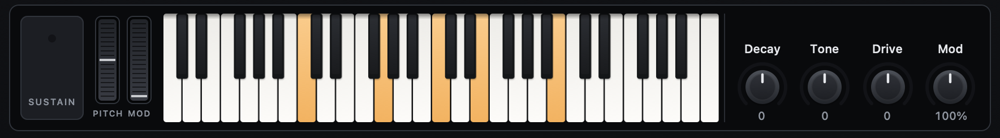

A playable 61-key keyboard (keys light up for notes being played, from the mouse or MIDI),
a **Sustain** switch and the pitch / modulation wheel displays. The modulation wheel adds
tremolo / vibrato depth.

---

## 3. The signal chain

| Stage | Choices | |
|---|---|---|
| **Resonator** | **Rhodes Tine** | A felt hammer strikes a cantilevered steel tine coupled to a tone bar. Simulated as a port-Hamiltonian system (Falaize & Hélie / PyPHS): energy is conserved exactly by the numerical scheme, so the hammer, tine and tone bar interact like real mechanics. |
| | **Wurli Reed** | A hammer strikes a steel reed with a solder tip mass. OpenWurli's modal reed model, calibrated per note across the 200A's 64 reeds. |
| **Pickup** | **Magnetic** | The Rhodes pickup: the tine tip moves through a magnet's field. Uses Falaize & Hélie's flux law, so the tone depends on where the tip sits relative to the pickup. Followed by the coil's resonance. |
| | **Electrostatic** | The Wurlitzer pickup: the reed swings into a charged comb. Uses OpenWurli's field-solved capacitance law, the main source of the Wurlitzer's characteristic harmonics. |
| **Amp** | **Suitcase** | A Rhodes-style preamp with smooth tube/JFET saturation and the Suitcase's stereo auto-pan tremolo. |
| | **200A Circuit** | The Wurlitzer 200A's amplifier, simulated component by component (OpenWurli): two-transistor preamp, vibrato made by an LED-and-photoresistor inside the preamp's feedback loop (so it changes tone, not only volume), volume network and power amp. |

The instrument buttons set these for you:

| Instrument | Resonator | Pickup | Amp |
|---|---|---|---|
| Mk I | Rhodes Tine | Magnetic | Suitcase |
| Dyno | Rhodes Tine (Dyno voicing) | Magnetic (closer, stronger pickups) | Suitcase |
| 200A | Wurli Reed | Electrostatic | 200A Circuit |
| Hybrid | Rhodes Tine | Electrostatic | 200A Circuit |

After choosing one, change any single stage in the strip:


---

## 4. Resonator controls

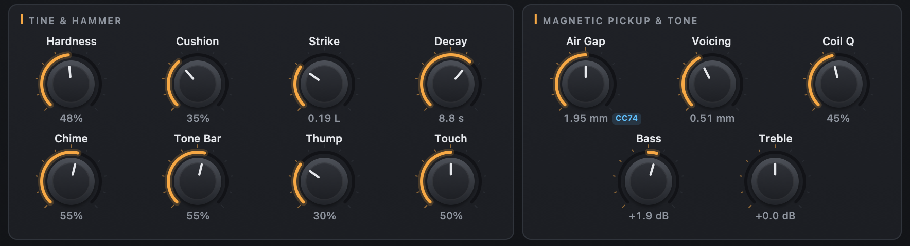

The eight knobs in the left panel shape the struck object. Their names change with the
resonator.

| Knob (Tine / Reed) | Rhodes tine | Wurlitzer reed |
|---|---|---|
| **Hardness** | Felt stiffness and its nonlinearity: harder felt gives a shorter contact and a brighter, more percussive attack. | Hammer contact as if struck harder: brighter onset. |
| **Cushion / Damper** | Felt damping: low = elastic snap, high = soft, absorbent felt. | Damper felt strength on release (centre = OpenWurli). |
| **Strike** | Where the hammer hits the tine (shown as a fraction of its length). Near the clamp excites more overtones. | — (not used by the reed) |
| **Decay** | Sustain time (shown as the T60 at middle C). | Sustain multiplier relative to the real 200A (×1.00 = calibrated). |
| **Chime / Overtones** | Level and length of the tine's bell partial (≈6.3 × the fundamental) and its high "ping". | Level of the reed's upper modes. |
| **Tone Bar / Tip Mass** | Coupling to the tone bar: sustain bloom and a slow shimmer (0.15–1 Hz beating). | Extra solder mass on the reed tip: moves the overtone frequencies. |
| **Thump / Attack** | Key-bed thud and felt click on the attack, plus the damper tap on release. | Level of the hammer's attack noise. |
| **Touch** | Velocity response: left = heavy (soft playing stays gentle), right = light (full tone even when played softly). | Same; centre = OpenWurli's response. |

With the reed selected:

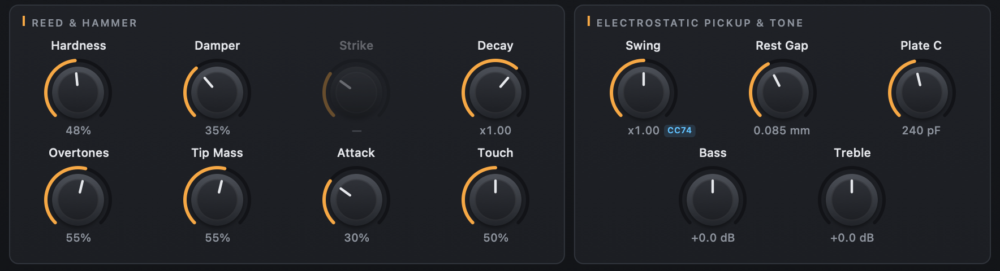

**Every reed and electrostatic control at its default position reproduces OpenWurli's
calibrated Wurlitzer 200A exactly.** Turn them to depart from it.

---

## 5. Pickup and tone controls

| Knob | Magnetic pickup | Electrostatic pickup |
|---|---|---|
| **Air Gap / Swing** | Horizontal distance from tine tip to pickup (mm). Closer = louder and more bark when you dig in. | How far the reed swings into the comb (×1.00 = factory). More swing = more harmonics. |
| **Voicing / Rest Gap** | Vertical offset of the tine tip from the pickup centre (mm). **Small values approach the pure octave "bell"**; larger values give a rounder fundamental. This is the real Rhodes voicing adjustment. | How far outside the finger band the reed rests (0.085 mm on a real 200A). Changes the balance of even harmonics. |
| **Coil Q / Plate C** | The coil's resonance: low = warm and dark, high = a singing presence peak. | Capacitance at the pickup plate (240 pF on a real 200A). Lower = higher corner = brighter. |
| **Bass, Treble** | ±16 dB shelving tone controls (140 Hz / 2.8 kHz), after the amp. | Same. |

---

## 6. Amp

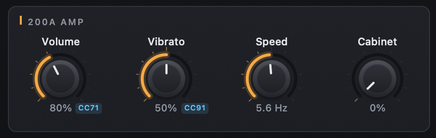

| Knob | Suitcase | 200A Circuit |
|---|---|---|
| **Drive / Volume** | Preamp saturation: clean to gritty. | The 200A's volume pot feeding the power amp. Push it to drive the amp into its rails (default 80 %). |
| **Tremolo / Vibrato** | Stereo auto-pan depth. | Vibrato depth: the photoresistor network inside the preamp's feedback loop. |
| **Speed** | Pan rate. | Vibrato rate. The 200A's own oscillator runs at about 5.6 Hz; the knob speeds it up or slows it down. |
| **Cabinet** | With the *Speaker (200A)* cabinet: character from direct (flat) up through small-speaker roll-off, cone saturation and thermal compression. With any other cabinet it becomes **Cab Drive**, how hard the speaker is pushed. See [Space](#10-space-reverb-echo-and-cabinets). | Same. |

The **mod wheel** adds tremolo / vibrato depth on top of the knob.

**Tremolo, phaser and echo can lock to the host tempo**, and the suitcase preamp can be
oversampled to keep hard saturation clean: see [section 8](#8-modulation-and-expression).

---

## 7. Effects

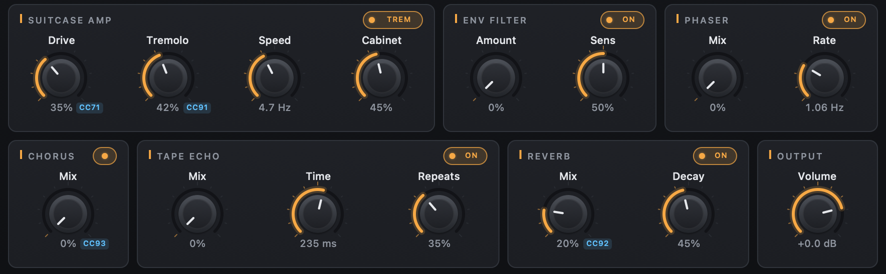

The effects follow the amp, in this order:

| Panel | Controls |
|---|---|
| **Env Filter** | An envelope-following resonant filter (auto-wah). **Amount** sets depth and mix; **Sens** sets how strongly your playing opens it. It sits in front of the amp, like a pedal. |
| **Phaser** | 4-stage optical phaser: **Mix**, **Rate**. |
| **Chorus** | Stereo BBD chorus: **Mix**. |
| **Tape Echo** | **Mix**, **Time** (40 ms – 1 s), **Repeats**. Repeats darken and saturate like tape; changing the time glides the pitch, like a tape-speed change. |
| **Reverb** | **Mix**, **Decay**. Hall or Spring: see [Space](#10-space-reverb-echo-and-cabinets). |
| **Output** | Master **Volume**. |

After the reverb come the [mastering EQ](#11-mastering-eq-and-dynamics), the **compressor** and
the **limiter**, then the output.

---

## 8. Modulation and expression

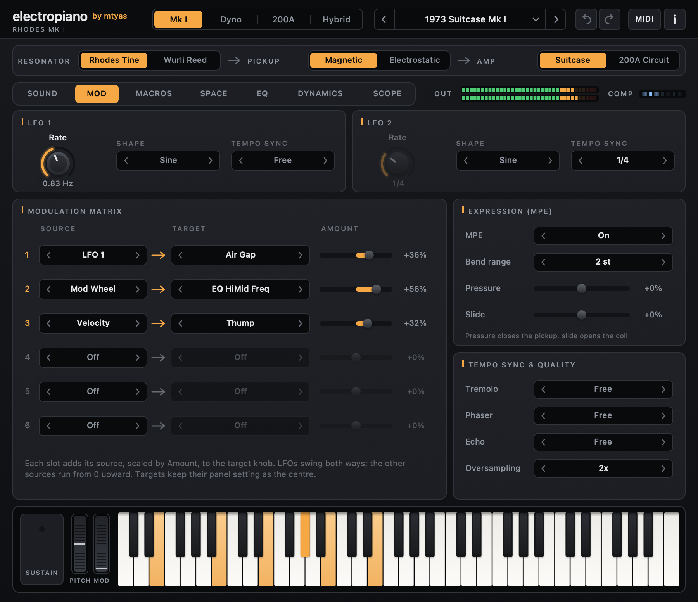

### LFOs and the modulation matrix

Two LFOs (**LFO 1**, **LFO 2**) each have a **Rate** (0.05 – 40 Hz), a **Shape** (sine, triangle,
saw, square, sample-and-hold) and a **Tempo Sync**: pick a division (1/1 … 1/8T) and the LFO locks
to the host tempo; the Rate knob is parked while a division is chosen.

The **matrix** has six slots. Each slot reads a **source**, scales it by an **amount**
(−100 % … +100 %) and adds it to a **target**. Click the source or target box to pick from a
list.

| Sources | |
|---|---|
| **LFO 1 / LFO 2** | Swing both ways around the target's own setting. |
| **Mod Wheel / Pressure** | 0 to 1: the wheel (CC 1) and channel / polyphonic aftertouch. |
| **Velocity / Key** | The last note's velocity and its position on the keyboard. |
| **Output Env** | How loud the instrument is playing: envelope-following modulation. |
| **Random** | A new random value on every note. |

Targets are 39 of the controls: the whole resonator, pickup, tone, amp and effects sections, plus
Material, Gap FM, Morph, three EQ gains and the cabinet's mic position and distance. Targets keep
their panel setting as the centre, so modulation never moves the knob itself.

### Expression and MPE


Turn **MPE** on for an MPE controller (Seaboard, Linnstrument, Osmose…). Each note then lives on
its own MIDI channel and has its own controllers:

- **Pitch bend** bends that note only, on tines and reeds, even while it rings. **Bend range**
  sets how far (1 – 48 semitones); channel 1 is the master channel and bends everything by ±2.
- **Pressure** pulls the pickup closer to the tine: more bark and level. **Pressure** and **Slide**
  have amount sliders (centre = no effect).
- **Slide** (CC 74 on a member channel) opens the pickup coil: a brighter, more singing tone.

With MPE off, pitch bend and aftertouch still work as a normal wheel and aftertouch.
**CLAP** hosts that send note expressions (tuning, pressure, brightness) drive the same
controls; in **VST3**, polyphonic pressure is supported, and note expressions where the host offers them.

### Tempo sync and quality

- **Tremolo**, **Phaser** and **Echo** each have a sync division: *Free* keeps the knob's Hz or
  milliseconds; any division locks the effect to the host tempo (AU and the standalone app assume
  120 BPM).
- **Oversampling** runs the suitcase preamp at 2× or 4× so heavy drive doesn't fold back as
  aliasing. 2× is the default; **Off** saves CPU. (The 200A circuit is always oversampled.)

---

## 9. Macros: the impossible instrument

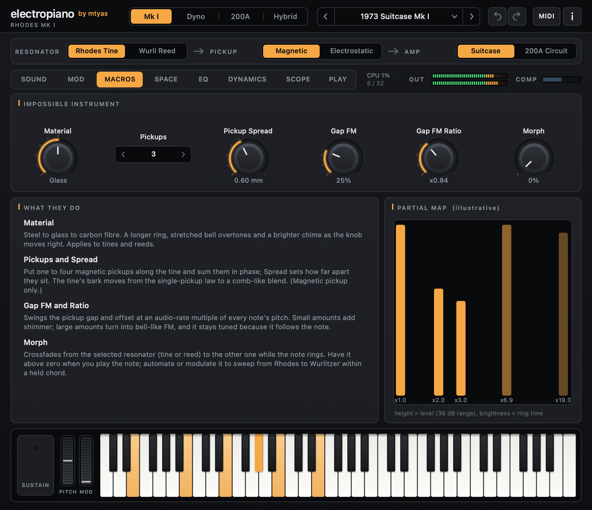

Because every part is simulated, you can go beyond what metal and magnets allow.

| Control | What it does |
|---|---|
| **Material** | Steel → glass → carbon fibre. Longer ring, stretched bell overtones and a brighter chime as you move right. Works on tines and reeds. |
| **Pickups / Spread** | One to four magnetic pickups along the tine, summed in phase. **Spread** sets how far apart they are. The single-pickup bark gives way to a comb-like blend. Magnetic pickup only. |
| **Gap FM / Ratio** | Swings the pickup gap and offset at an audio-rate multiple of every note's pitch (0.25× – 8×). A little adds shimmer; a lot is bell-like FM. It stays in tune because it follows the note. |
| **Morph** | Crossfades from the selected resonator to the other one **while the note rings**: a tine becomes a reed, or the other way round. Have Morph above zero when you play the note; automate or modulate it to sweep. |

The **partial map** on the right shows the resonator's overtones (height = level, brightness =
ring time) and moves as you turn Material and Chime. It is an illustration of the model's
settings, not a measurement.

---

## 10. Space: reverb, echo and cabinets

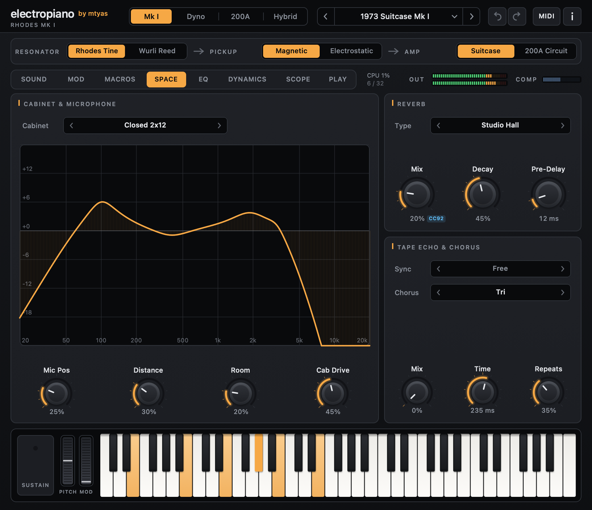

### Cabinet and microphone

Choose a cabinet from the list. **Speaker (200A)** is the original OpenWurli speaker; the rest are
miked cabinets:

| Cabinet | Character |
|---|---|
| **Suitcase 4x10** | The classic Rhodes suitcase: full lows, round mids. |
| **Twin 2x12 Open** | Open-back, clean and sparkly. |
| **Deluxe 1x12** | Small and punchy, warm break-up. |
| **Closed 2x12** | Tight and mid-forward. |
| **Studio Condenser** | Wide and bright, almost flat. |
| **Ribbon Mic** | Dark and smooth. |
| **Hi-Fi Monitor** | Nearly neutral. |
| **Radio** | Narrow and nasal. |
| **Lo-Fi** | Small, crunchy and harsh. |

The plot shows the cabinet's frequency response and updates as you move the controls.

- **Mic Pos**: from the middle of the cone (bright, with a presence peak) to the edge (darker, with
  a slight comb filter).
- **Distance**: close up you get proximity bass; further away the lows relax, the highs soften with
  air, and the room comes in.
- **Room**: early reflections, from a dry booth to a live room.
- **Cab Drive**: the main panel's Cabinet knob, which pushes the speaker harder.

### Reverb and tape echo

**Reverb** has four types:

- **Studio Hall** (the default): an eight-line feedback delay network, true stereo, with a darker
  tail as Decay comes down and slow modulation that keeps it from ringing metallically.
- **Plate**: the classic plate topology published by Jon Dattorro: dense, bright and smooth.
- **Spring**: a dispersive spring tank (the "boing" of two springs).
- **Classic Hall**: the hall of earlier versions (projects saved with them keep it).

**Mix** and **Decay** are the same knobs as on the Sound page; **Pre-Delay** (0 – 120 ms) holds the
reverb back so the attack stays clear. **Tape Echo** has the same controls plus a **Sync** division.
**Chorus** is a *Tri* chorus (three bucket-brigade taps sweeping 120° apart, left / centre / right,
through the BBD's low-pass) or the earlier *Dual* two-tap chorus.

---

## 11. Mastering EQ and dynamics

### Mastering EQ

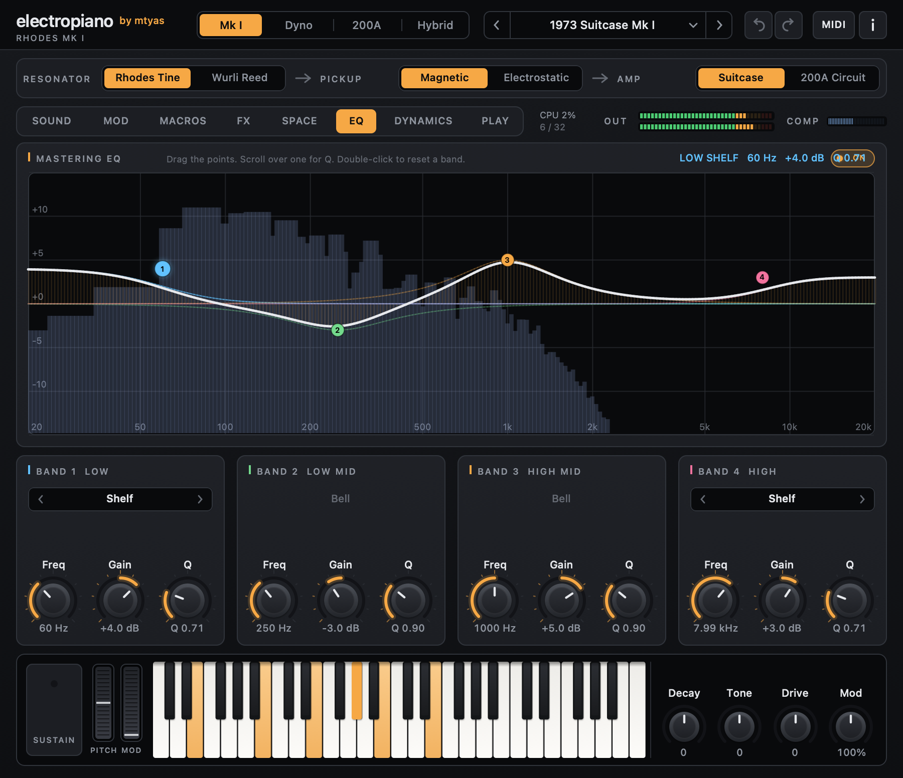

A four-band stereo parametric equaliser at the end of the chain (after reverb), with a live
spectrum of the output behind the curve.

- **Drag the numbered points** to set a band's frequency (left–right) and gain (up–down).
- **Scroll** over a point for its **Q** (width). **Double-click** a point to flatten that band.
- The cards below hold the same settings as knobs. **Band 1** (low) and **Band 4** (high) can be a
  **shelf** or a **bell**; Bands 2 and 3 are bells.
- Each band is ±12 dB; the white line is the combined response. A band at 0 dB costs nothing.

### Compressor and limiter

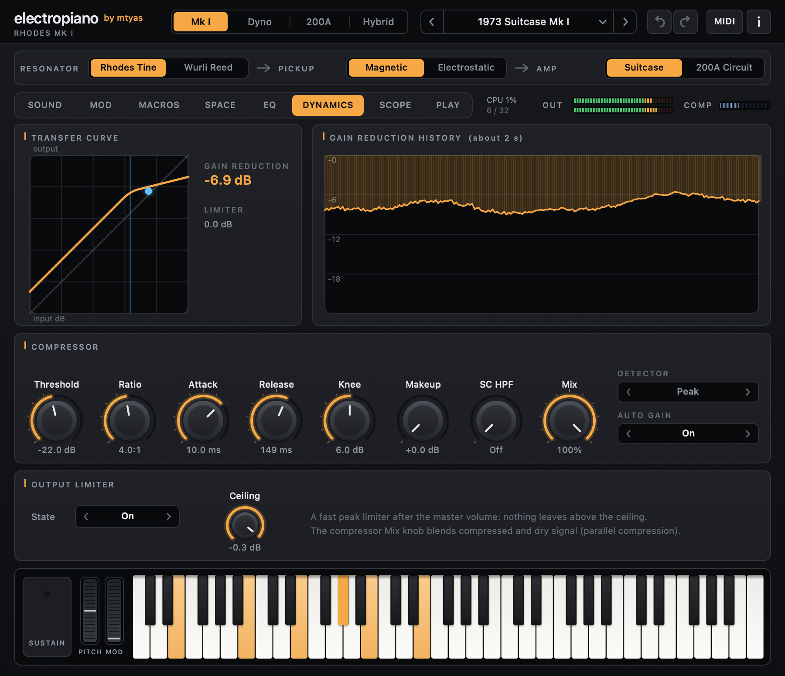

A stereo-linked bus compressor with every control you'd expect:

| Control | |
|---|---|
| **Threshold** | −40 … 0 dB. |
| **Ratio** | 1:1 … 20:1. |
| **Attack / Release** | 0.1 – 100 ms and 10 – 1000 ms. |
| **Knee** | 0 – 12 dB of soft knee. |
| **Makeup** | 0 – 18 dB, plus **Auto Gain** to make up automatically. |
| **SC HPF** | High-pass the detector (20 – 400 Hz) so bass doesn't pump the mix. |
| **Detector** | **Peak** or **RMS**. |
| **Mix** | Dry / compressed blend (parallel compression). **0 % = the compressor is off.** |

The **transfer curve** shows the compressor's behaviour and a blue dot for the signal right now; the
**history** scrolls the last two seconds of gain reduction.

The **Output Limiter** sits after the master volume: switch it on and nothing leaves above the
**Ceiling**.

---

## 12. Scope

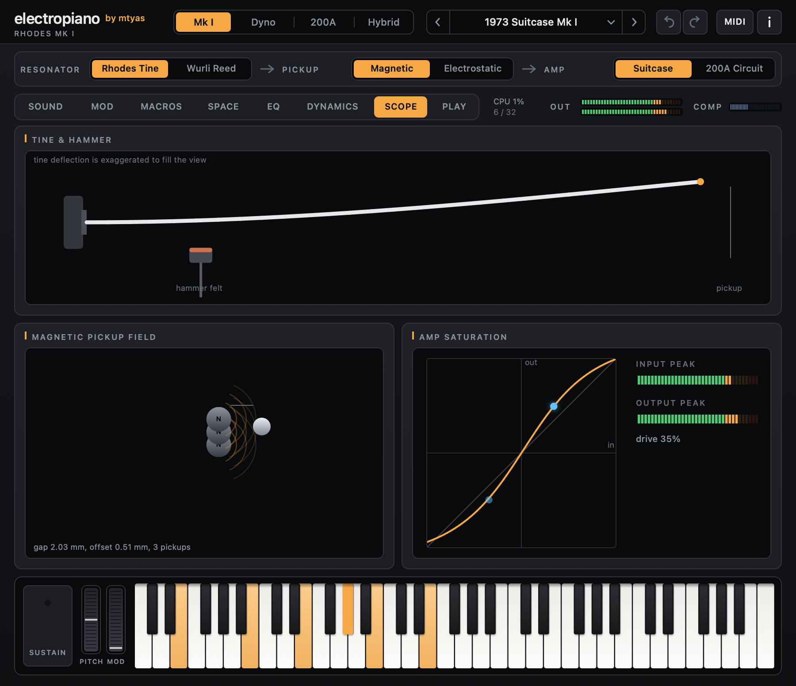

Because the physics is real, you can watch it:

- **Tine & Hammer**: the tine bends like a cantilever; the hammer rises into it, squashes its felt at
  the moment of contact and drops away. Deflection is exaggerated to fill the view.
- **Pickup Field**: the magnet (or several, with the Pickups macro), the field around it and the tine
  tip moving through it, with the gap and offset in millimetres. Gap FM makes it visibly wobble. On the
  electrostatic pickup it shows the reed swinging through the comb.
- **Amp Saturation**: the preamp's transfer curve with a live dot for the signal level and input and
  output peak meters. Turn **Drive** up and watch the curve bend.

---

## 12b. Play: tuning, pedals and realism

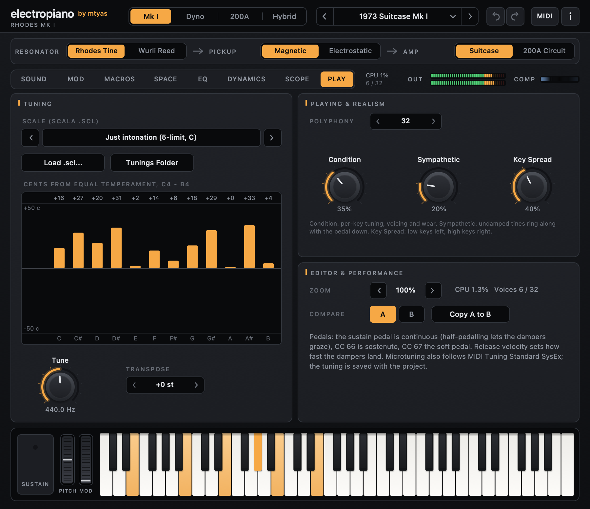

### Tuning and microtuning

- **Tune** sets concert pitch (A4 = 415 – 466 Hz); **Transpose** moves the keyboard ±24 semitones.
- **Scale** chooses a tuning: 12-TET, built-in just intonation, Pythagorean, quarter-comma meantone,
  Werckmeister III, 19-, 24- and 31-EDO, and every **Scala** file (`.scl`) in your Tunings folder.
  A `.kbm` keyboard mapping with the same name is used with its scale (keys it leaves unmapped stay
  silent). **Load .scl…** opens a file and copies it to the Tunings folder; **Tunings Folder** opens it.
- The chart shows how far each note of one octave sits from equal temperament.
- With no `.kbm`, scale degree 0 is middle C and A4 is at the Tune frequency.
- **MIDI Tuning Standard** SysEx (single-note and scale/octave tuning) retunes the instrument too.
- The tuning is **saved with your project**, so it plays back the same on a machine without the file.

The Tunings folder is next to the Presets folder (for example
`~/Library/Application Support/mtyas/electropiano/Tunings` on macOS).

### Playing and realism

- **Polyphony**: 8 – 64 voices. When it runs out, the quietest voice is taken, with a short fade.
- **Condition**: each key gets its own small differences, as on a real, played instrument: tuning a
  few cents off, uneven voicing, decay and hammer wear. The same key is always the same. 0 % is a
  factory-perfect instrument.
- **Sympathetic**: with the sustain pedal down, the undamped tines ring along with what you play,
  each at its own (tuned) pitch.
- **Key Spread**: low keys to the left, high keys to the right.

### Editor and comparing

- **Zoom** 75 – 200 % (see [Installing](#1-installing)).
- **A / B** keeps two versions of your sound: edit, switch to B, edit again and switch back to compare.
  **Copy A to B** (or B to A) starts the other side from the current sound.

---

## 13. Presets

Click the preset name to open the browser:

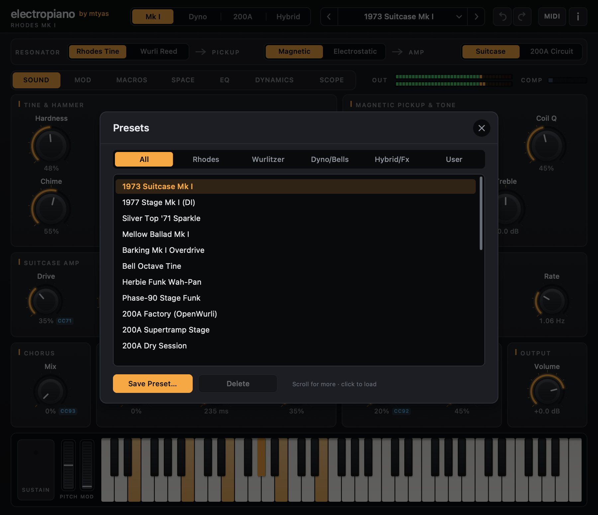

- Filter by category with the tabs; **scroll** for more; click a preset to load it.
- **Type** to search names and descriptions (**Enter** loads the first match, **Esc** clears).
- Click the **star** next to a preset to make it a favourite; the **Favourites** tab lists them.
- The line under the list describes the selected preset.
- **Save Preset…** stores the current sound as a user preset. Type a name and press
  **Enter** (or **Save**); **Esc** cancels.

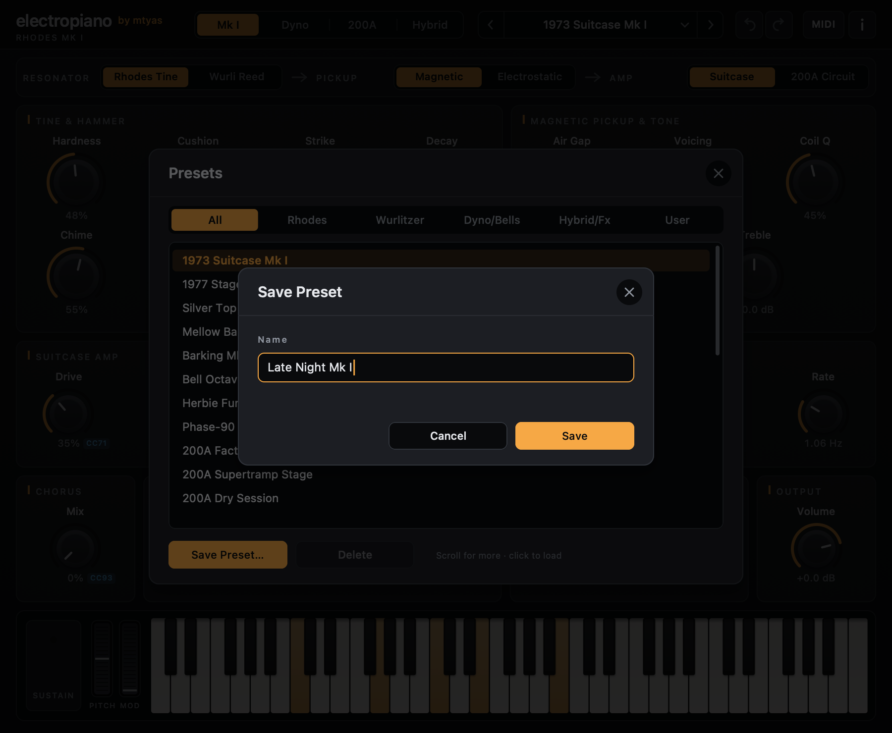

- To delete a user preset, select it and click **Delete**. Factory presets can't be deleted.
- User presets are files in:
  - macOS: `~/Library/Application Support/mtyas/electropiano/Presets`
  - Windows: `%APPDATA%\mtyas\electropiano\Presets`
  - Linux: `~/.local/share/mtyas/electropiano/Presets`

### Factory presets

| Category | Presets |
|---|---|
| **Rhodes** | 1973 Suitcase Mk I · 1977 Stage Mk I (DI) · Silver Top '71 Sparkle · Mellow Ballad Mk I · Barking Mk I Overdrive · Bell Octave Tine · Herbie Funk Wah-Pan · Phase-90 Stage Funk |
| **Wurlitzer** | 200A Factory (OpenWurli) · 200A Supertramp Stage · 200A Dry Session · 200A Cranked Bark · 200A Vibrato Lounge · 200A Tape Echo · 200A Psychedelic Phase |
| **Dyno / Bells** | Dyno-My-Piano LA Bell · 80s Ballad Chorus EP · Dyno Tine Shimmer · Glass Tine |
| **Hybrid / FX** | Hybrid: Tine into 200A · Hybrid: Reed into Suitcase · Reed on Magnetic, 200A Amp · Tine on Comb, Suitcase · Mu-Tron Funk Machine · Dub Echo Chamber · Ambient Tine Pad · Sub-Bark Bass EP · Lo-Fi Cassette Keys |

**200A Factory (OpenWurli)** is OpenWurli's calibrated Wurlitzer with every control at its
reference position — a good place to start for an authentic 200A.

---

## 14. Playing, MIDI and automation

- **Velocity** drives the hammer physically: playing harder strikes harder, which changes the
  tone, not just the level.
- **Sustain pedal** (CC 64) and the on-screen **Sustain** switch hold notes; the dampers land
  when you release. A continuous pedal **half-pedals**: part-way down, the dampers only graze the
  tines and the notes die away slowly. **Sostenuto** (CC 66) holds just the notes whose keys are
  down when you press it; the **soft pedal** (CC 67) makes notes struck while it is down softer and
  rounder. **Release velocity** (how fast you let go of a key) sets how fast the damper lands.
- **Repeated notes** strike the tine that is still ringing, as on the instrument, so fast repeats
  build on each other instead of restarting.
- **Notes are placed at the exact sample** the host sends them in every format, so timing doesn't
  depend on the buffer size.
- **Mod wheel** (CC 1) adds tremolo / vibrato depth.
- **All 109 controls are automatable** from your DAW, including the three stage switches and every
  modulation slot. In **CLAP** hosts that support it (such as Bitwig), continuous controls also accept
  **host parameter modulation**: an offset added to the knob without moving it.
- **MPE**, **pitch bend**, **aftertouch** and **tempo sync** are described in
  [section 8](#8-modulation-and-expression).

### MIDI Learn

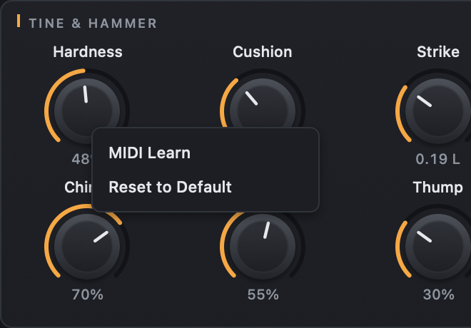

1. Right-click a knob and choose **MIDI Learn** (or click **MIDI** in the header, then click
   a knob). The knob shows `LEARNING`.
2. Move a controller on your MIDI device. The knob is now mapped and shows its CC number.
3. To remove a mapping, right-click the knob and choose **Forget MIDI CC**.

Factory mappings: CC 71 Drive, CC 74 Air Gap, CC 91 Tremolo, CC 92 Reverb, CC 93 Chorus.
Mappings are saved with your project.

---

## 15. Tips for sound design

- **Bark comes from the pickup, not the amp.** For a growling Rhodes, move **Air Gap** up
  (closer) and play hard; **Voicing** decides whether the extra harmonics lean to the octave
  or the fifth.
- **The octave bell.** Turn **Voicing** fully down on a magnetic pickup: with the tine centred
  on the pickup, the fundamental cancels and the octave rings out (preset *Bell Octave Tine*).
- **A Wurlitzer's edge comes from its comb.** On the electrostatic pickup, more **Swing** or a
  smaller **Rest Gap** pushes the reed deeper into the fingers.
- **Real 200A vibrato is timbral.** It modulates the preamp's feedback, so the tone moves as
  well as the level. Try it on a Rhodes tine (Hybrid).
- **Drive the 200A.** Its **Volume** knob above about 70 % pushes the power amp into its rails,
  as cranking a real 200A does.
- **Hybrids worth trying:** Rhodes tine → electrostatic → 200A (glassy, vocal); Wurli reed →
  magnetic → Suitcase (a reedy Rhodes with stereo pan).
- **Morph a held chord.** Set **Morph** above zero, hold a chord and sweep it with the mod wheel
  (Mod page: Mod Wheel → Morph) to turn Rhodes into Wurlitzer under your fingers.
- **Let the keyboard play the tone.** Route **Velocity** to **Chime** or **Pressure** to **Air Gap**
  in the matrix so how you play changes the timbre, not just the level.
- **Glue with the compressor, not the volume.** Use **Mix** around 30 – 50 % with a slow attack
  for punchy parallel compression; add a touch of **Material → Glass** for a longer ring.
- **EQ the cab, then the mix.** Choose a cabinet and move **Mic Pos** before reaching for the EQ: the
  cabinet already shapes the tone like a real one would.
- **Tone bar for pads.** High **Tone Bar** and long **Decay** give a blooming, shimmering
  sustain (preset *Ambient Tine Pad*).

---

## 16. Troubleshooting

| Problem | Try |
|---|---|
| macOS says the plugin is damaged or can't be opened | Remove the quarantine flag (see [Installing](#1-installing)). |
| The DAW doesn't list electropiano | Check the folder for the format and rescan. On Windows, make sure you copied the whole `electropiano.vst3` folder. |
| No sound from the 200A at first | The 200A circuit settles for a moment when the plugin loads; play again after a second. |
| Too quiet / too loud | Use **Output → Volume**. Presets are levelled to sit around −20 dBFS RMS. |
| Changing Resonator or Pickup doesn't affect ringing notes | Those two stages are chosen when a note starts: the next note uses the new stage. Amp changes are immediate. |
| Morph does nothing on a held note | Morph is read when a note starts: have it above zero before you play. After that you can move it freely. |
| Choosing a cabinet doesn't seem to do anything | Make sure the Cabinet isn't set to *Speaker (200A)*; the other cabinets are always in the signal. The plot on the Space page shows what it does. |
| The compressor isn't doing anything | Its **Mix** knob is the on switch: at 0 % it is off. |
| Pitch bend or MPE has no effect | Turn **MPE** on for MPE controllers and set **Bend range** to match; check the host passes pitch bend and aftertouch to the plugin (VST3 hosts often don't: try CLAP or AU). |
| A loaded Scala file sounds wrong | Without a `.kbm`, degree 0 is middle C and A4 sits at the Tune frequency; add a `.kbm` with the same name to map it differently. Keys a `.kbm` marks `x` are silent. |
| The editor is too small or too large | Set **Zoom** on the Play page, or drag the window corner where the host allows it. |
| Typing doesn't reach the save dialog | Some hosts keep keyboard input for themselves: click inside the editor first, or save the preset from the standalone app (macOS). |

---

## 17. How it works

**Rhodes tine.** Following Falaize & Hélie's port-Hamiltonian Rhodes model (and the PyPHS
components it is built from), the hammer is a mass with a nonlinear felt
($H = \frac{k}{\alpha+1}\xi^{\alpha+1}$, damping $\propto \xi^{\alpha-1}\dot\xi$), the tine is a
clamped–free Euler–Bernoulli beam (modes at 1, 6.27 and 17.55 × f₀) coupled to a tone bar,
and contact is solved with a discrete-gradient scheme. The discrete energy balance
$\Delta H + \Delta t\,P_{\text{diss}} = 0$ holds on every sample (verified to about 10⁻¹⁵ of
the stored energy, through hammer contact). The magnetic pickup applies their flux law
(eq. 25), with the horizontal and vertical tip offsets as controls.

**Wurlitzer 200A.** A C++ port of OpenWurli: a 7-mode reed with per-note tip mass, dwell and
damping; the electrostatic pickup's field-solved capacitance law; the 9-node DK/MNA preamp
(2N5089 transistors); the Twin-T oscillator driving the vibrato LED; the photoresistor in the
preamp's feedback loop; the volume network; the power amp; and the speaker. The port is
checked against OpenWurli's SPICE-derived targets (preamp DC point within 0.1 mV, 15.56 dB at
1 kHz, 880.5 Hz pickup corner, 0.37–2.28 mA LED current at 5.56 Hz).

**Per-note expression.** A voice's modes are retuned in flight: the tine's stiffness values are
recomputed from the bent pitch every few milliseconds, and the reed's modes are phasors whose
rotation step is changed without disturbing their state, so a bend is seamless. Pressure and slide
move the pickup gap and the coil resonance per note.

**Modulation.** The matrix adds source × amount to each target's smoothed value before the voices and
effects read it; voices re-derive what they need (modal damping, pickup geometry) when it moves.

**Macros.** Material scales the tine's decay, the stretch of its bell modes and their pickup weight.
Several pickups sum Falaize & Hélie's flux law at offset positions; Gap FM modulates the gap and
offset with a phasor locked to the note; Morph runs a tine and a reed in the same voice, each through
its own pickup chain, and crossfades them with equal power.

**Mastering chain.** The EQ is four RBJ biquads per channel; the compressor is a stereo-linked
feed-forward design with a quadratic soft knee and ballistics applied to the gain reduction in dB;
the limiter has instant attack and a smooth release. The cabinets are procedural: a speaker voicing
(high-pass, two low-pass poles, four resonant bells) followed by a microphone model (a proximity
shelf, a presence peak, a short comb for off-axis, five early reflections). The editor draws the
EQ and cabinet curves from the very same filters, so the curve is what you hear.

**Editor.** One editor shared by all platforms. macOS draws it with CoreGraphics; Windows and
Linux draw it with a built-in anti-aliased renderer using the Inter typeface, so it looks the
same everywhere.

---

## 18. Credits and licence

- **electropiano** — Matthew Tyas (mtyas) · [mtyas.com](https://mtyas.com) ·
  [Support on Ko-fi](https://ko-fi.com/mtyas)
- **Rhodes model** — after Antoine Falaize and Thomas Hélie, *"Passive simulation of the
  nonlinear port-Hamiltonian modeling of a Rhodes piano"*, Journal of Sound and Vibration 390
  (2017), and the [PyPHS](https://github.com/pyphs/pyphs) project (GPL-3.0). No PyPHS code is
  included; the published equations are implemented independently.
- **Wurlitzer 200A model** — [OpenWurli](https://github.com/hal0zer0/openwurli) by hal0zer0
  and contributors (GPL-3.0), ported to C++.
- **Inter** typeface (Windows / Linux editor) — The Inter Project Authors, SIL Open Font
  License 1.1.

electropiano is free software under the **GNU General Public License v3.0 or later**. See
[LICENSE](../LICENSE).
