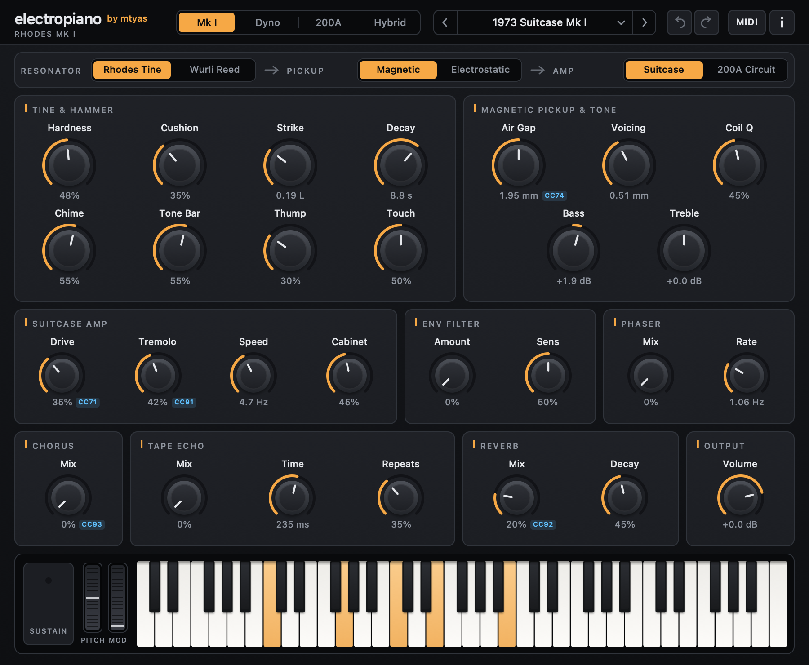

## electropiano v0.77 — first public release

Physically modelled **Rhodes** and **Wurlitzer 200A** electric pianos, built from stages you
can swap. CLAP and VST3 on macOS, Windows and Linux; Audio Unit and a standalone app on macOS.

### What's inside

- **Rhodes tine** — port-Hamiltonian hammer, tine and tone bar after Falaize & Hélie / PyPHS,
  solved with an energy-conserving discrete-gradient scheme; their magnetic pickup flux law.
- **Wurlitzer 200A** — a C++ port of [OpenWurli](https://github.com/hal0zer0/openwurli): reed,
  electrostatic pickup, DK preamp with the LDR vibrato in its feedback loop, power amp and
  speaker, checked against OpenWurli's SPICE-derived targets.
- **Swappable stages** — Resonator (tine / reed) → Pickup (magnetic / electrostatic) → Amp
  (Suitcase / 200A circuit).
- **Effects** — envelope filter, phaser, chorus, tape echo, reverb, cabinet.
- **28 presets**, 32 automatable controls, MIDI learn, undo/redo, user presets.
- **The same editor on macOS, Windows and Linux.**

### Downloads

| File | Contents |
|---|---|
| `electropiano-v0.77-macOS-Universal.zip` | CLAP, VST3, AU, standalone app (Apple Silicon + Intel) |
| `electropiano-v0.77-Windows-x64.zip` | CLAP, VST3 |
| `electropiano-v0.77-Linux-x64.tar.gz` | CLAP, VST3 (X11) |

Installation and every control are explained in the
[user manual](https://github.com/mtyas/electropiano/blob/main/docs/MANUAL.md).

### Known limitations

- macOS builds are not notarised: see the manual if macOS blocks them.
- The Windows and Linux builds are compiled and tested by CI but have had less hands-on testing
  in hosts than the macOS build. Reports are welcome.
- The editor is a fixed 900 × 740 pixels; on Windows and Linux it isn't scaled for high-DPI
  displays yet.

### Credits

Rhodes model after Antoine Falaize & Thomas Hélie (J. Sound Vib. 390, 2017) and PyPHS.
Wurlitzer 200A model from OpenWurli by hal0zer0 and contributors. Licensed GPL-3.0-or-later.
